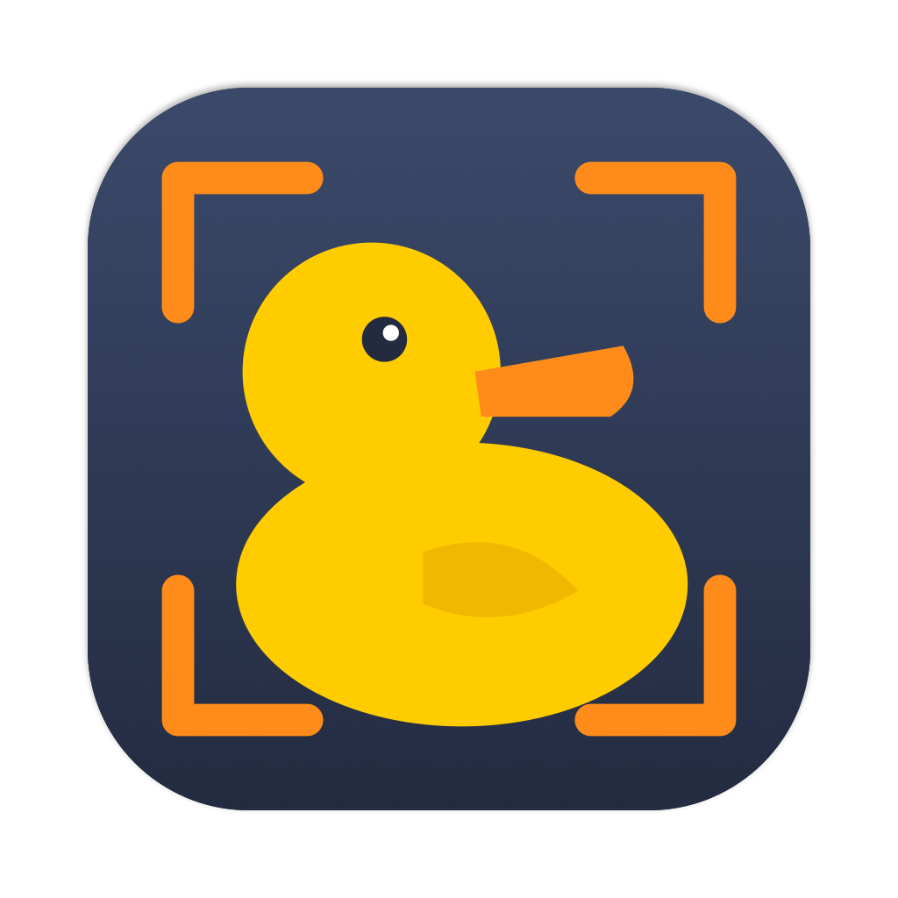

<p align="center">
  
</p>

<h1 align="center">quackShot for macOS</h1>

<p align="center"><b>A Flameshot-style screenshot and annotation tool, native on the Mac.</b><br>
Quack — like the duck.</p>

The macOS sibling of [quackShot for Linux](../quackShot). It lives in the menu
bar; press **⇧⌘2**, drag out a region of the frozen screen, annotate it in
place, then copy it, save it or pin it above your other windows. Swift + AppKit,
ScreenCaptureKit for capture, no dependencies.

## Features

- **Region capture** on every display at full Retina resolution, with a pixel
  magnifier, live size readout, resize handles and arrow-key nudging.
- **Annotation tools**: pencil, line, arrow, rectangle, ellipse, highlighter
  marker, text (a real text view, so Pinyin and other input methods work),
  pixelate, and numbered counters. Shift constrains to squares, circles, 45°.
- **Colour wheel** on right-click, **thickness** on scroll — both remembered.
- **Undo / redo** for every annotation.
- **Outputs**: clipboard, save (panel or straight to a folder), PNG on stdout,
  and **pinned** floating windows (drag, scroll to zoom, ⌥-scroll for opacity,
  double-click or Esc to close, right-click menu).
- **Menu bar app** with a configurable global shortcut, launch at login,
  delayed and full-screen capture, notifications that reveal the saved file.
- **CLI** compatible with the Linux version (`gui`, `full`, same flags and exit codes).

## Install

Requires macOS 14 Sonoma or later and the Xcode Command Line Tools.

```sh
scripts/build.sh --install      # builds dist/quackShot.app and copies it to /Applications
open /Applications/quackShot.app
```

`scripts/build.sh --zip` also writes a distributable zip to `dist/`.

## Permissions

The first launch opens a short **permission guide**:

| Permission | Needed? | Why |
| --- | --- | --- |
| Screen Recording | **Required** | Reading the screen. quackShot records no video and sends nothing anywhere. |
| Notifications | Optional | "Saved / Copied" confirmations; click to reveal the file. |
| Accessibility, Input Monitoring | Not needed | The hot key uses `RegisterEventHotKey`, which needs neither. |

The guide shows each permission's live status, opens the right pane of System
Settings, and offers **Relaunch quackShot** — macOS only applies a Screen
Recording grant to a freshly started app. It reappears automatically if the
permission goes missing later, and the menu bar menu shows a warning item
until it is fixed. You can open it any time from **Permissions…** in the menu.

Two macOS quirks worth knowing:

- quackShot is ad-hoc signed, so **every rebuild counts as a new app** for
  Screen Recording. If quackShot is ticked in System Settings but captures
  still fail, select its entry, click **−**, and grant again from the guide.
- macOS 15 periodically re-confirms screen access for screenshot apps with a
  system prompt; choose *Allow* to keep using quackShot.

## Using the editor

| Action | Mouse / key |
| --- | --- |
| Select a region | drag; drag inside to move; drag edges/corners to resize |
| Select the whole screen | ⌘A |
| Pick a tool | toolbar, or P L A R C M T B N (pencil, line, arrow, rect, circle, marker, text, blur, counter); press again to go back to moving |
| Colour | right-click, or the colour button |
| Thickness / font size | scroll |
| Constrain shape | hold Shift while drawing |
| Finish text | Esc, ⌘Return, or click elsewhere (Return adds a line) |
| Undo / redo | ⌘Z / ⇧⌘Z |
| Nudge / resize selection | arrow keys / Shift+arrow keys |
| Copy and close | Return or ⌘C |
| Save | ⌘S |
| Pin to screen | ⌘P |
| Quit | Esc |

## Command line

The executable inside the bundle is also a CLI:

```sh
alias quackshot=/Applications/quackShot.app/Contents/MacOS/quackShot
quackshot gui -p ~/Desktop/            # Return saves into the folder
quackshot gui -r > shot.png            # PNG on stdout
quackshot full -d 3000 -c              # all screens to the clipboard in 3 s
quackshot full -g 800x600+0+0 -p shot.jpg
```

With no arguments it starts the menu bar app. `quackshot --help` lists every
option; exit status is 0 on success, 1 when cancelled, 2 on errors. Screen
Recording permission applies to whichever app launches it — from a terminal,
that is the terminal.

## Configuration

**Settings…** in the menu covers the shortcut, save folder, file-name pattern
(strftime, e.g. `quackshot_%Y-%m-%d_%H-%M-%S`), save-without-asking,
copy-on-save, notifications, shutter sound, magnifier and launch at login.
Everything is stored in `~/Library/Application Support/quackShot/config.json`
with the same keys as the Linux version, plus `hotkey`, `play_sound` and
`onboarding_done`.

## Development

```sh
swift test                                   # core: geometry, drawing/export, CLI, config
swift build && .build/debug/quackShot selftest /tmp/qs   # drives the editor offscreen, writes renders
scripts/build-icon.sh                        # regenerate the icon
```

`selftest` needs no permissions and shows nothing on screen: it feeds
synthetic mouse and keyboard events to the editor and checks the results.
`QUACKSHOT_FAKE_CAPTURE=/path/to/image.png` makes captures use a file instead
of the screen.

## License

MIT — see [LICENSE](LICENSE).
